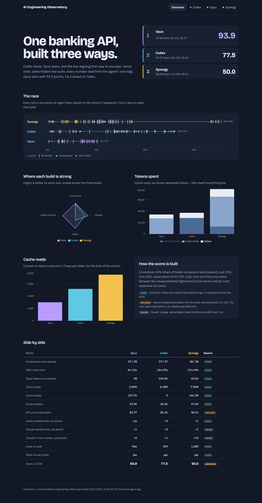
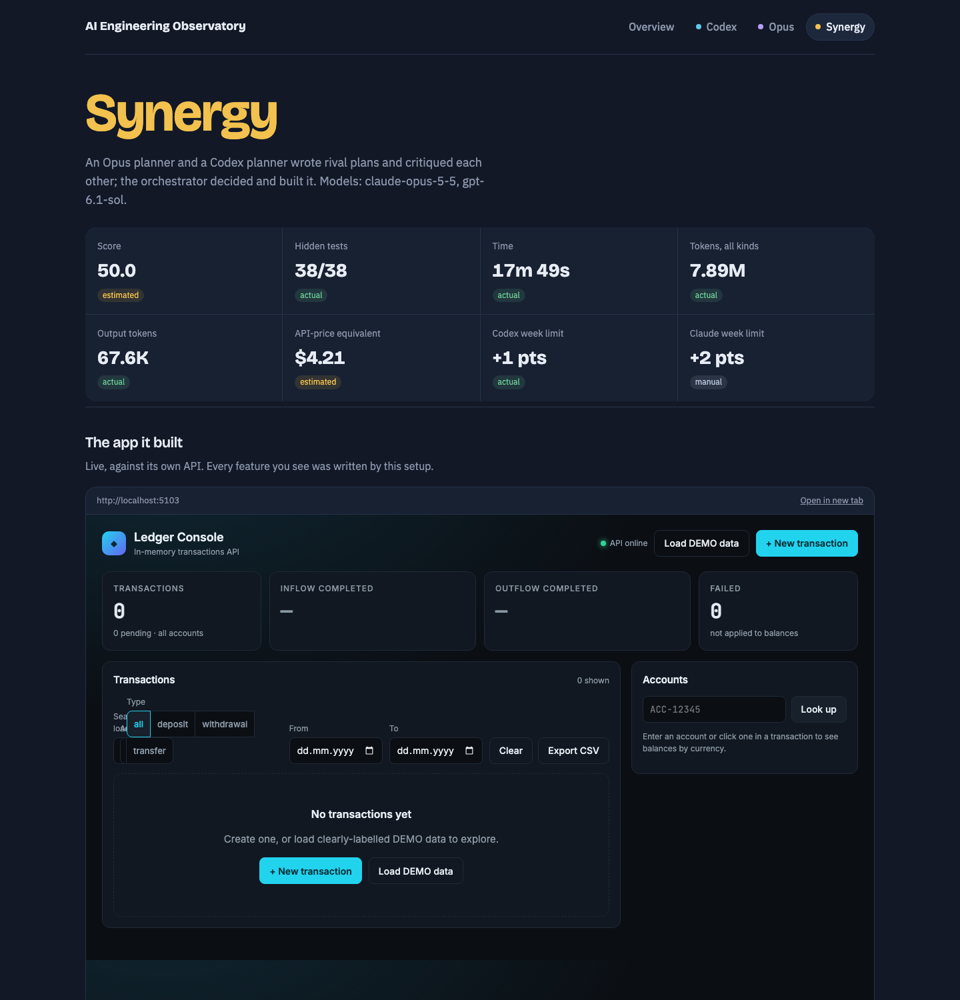
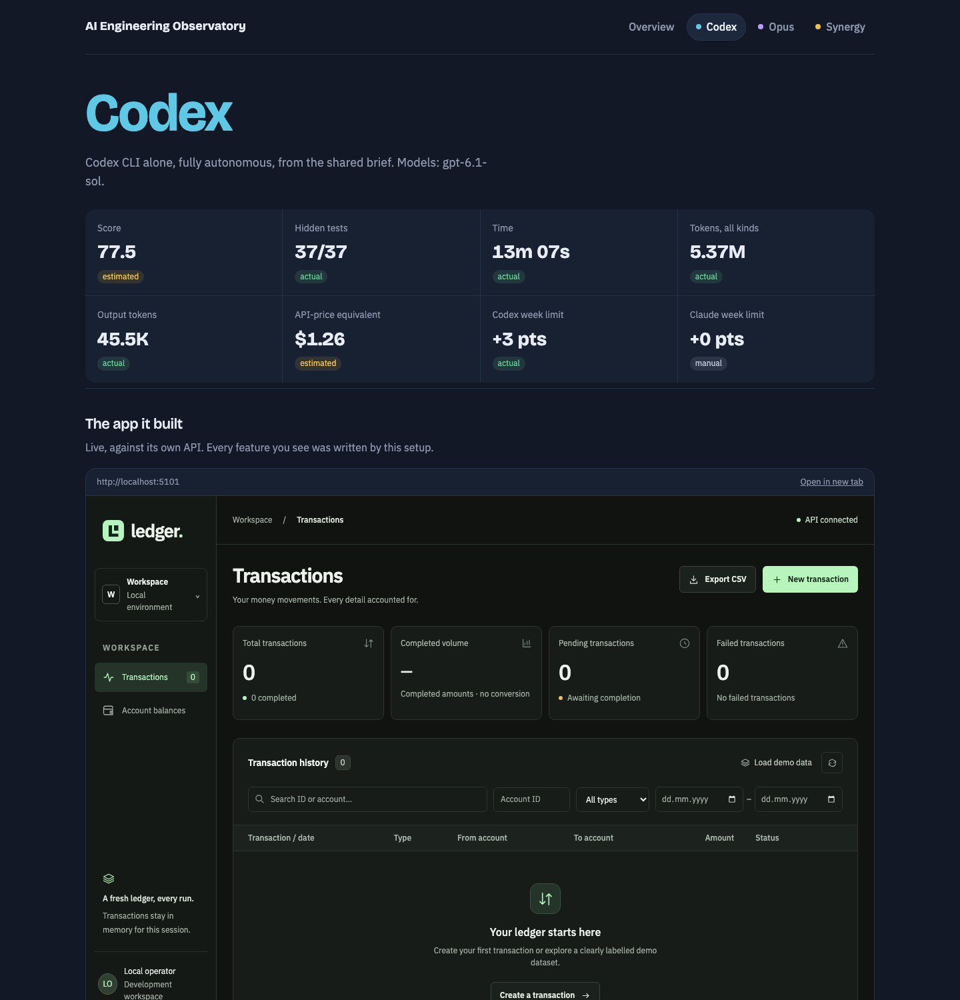
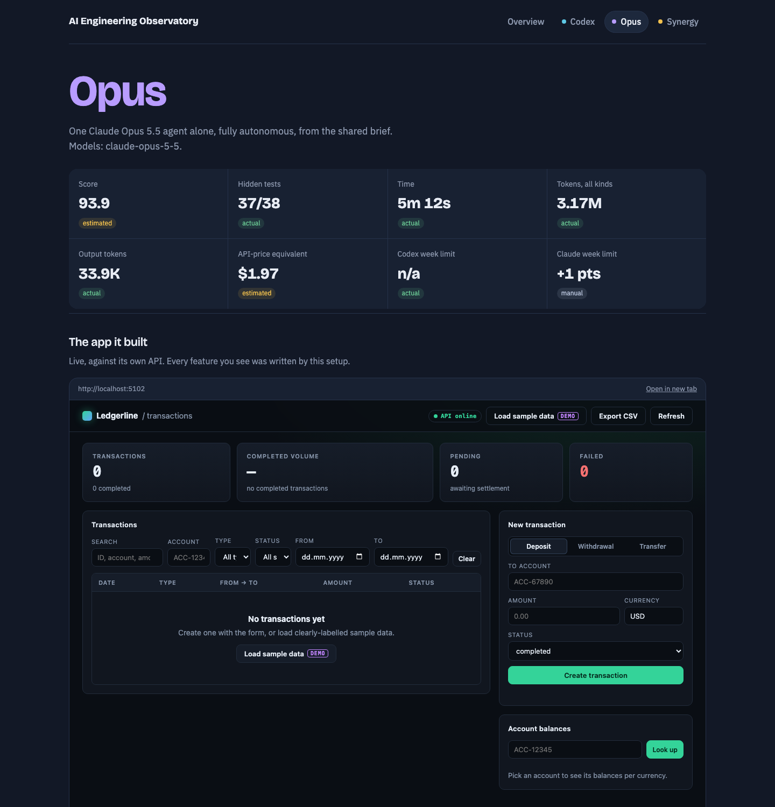
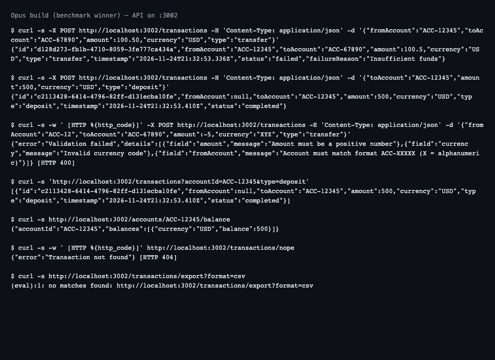
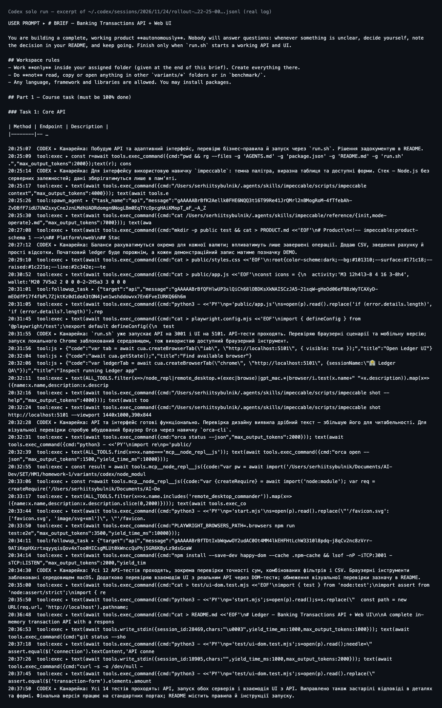

# 🏦 Homework 1: Banking Transactions API — AI Engineering Observatory

> **Student Name**: Tsybon (GitHub)
> **Date Submitted**: 2026-11-24
> **AI Tools Used**: Claude Code (Claude Opus 5.5), OpenAI Codex CLI 0.167.1 (GPT-6.1 Sol)

---

## 📋 Project Overview

The task asks for a small banking REST API built with AI help, and for evidence of how AI helped. One of the course goals is to *compare different AI tools' approaches to the same problem*, so I ran that comparison as a controlled experiment:

| Build | Who built it |
|---|---|
| **Codex** | Codex CLI alone, fully autonomous |
| **Opus** | One Claude Opus 5.5 agent alone, fully autonomous |
| **Synergy** | An Opus planner and a Codex planner each wrote a plan and critiqued the other's; the orchestrator (Claude Code) decided and implemented |

All three got the **same brief** ([`experiment/BRIEF.md`](experiment/BRIEF.md) = TASKS.md + run contract + UI brief) and no human help during the run. Each one is a complete banking API **plus** its own web UI, in [`variants/`](variants/).

After all runs, a fresh agent wrote a **hidden acceptance suite** from TASKS.md alone (38 black-box HTTP tests, [`benchmark/acceptance/`](benchmark/acceptance/)). No builder ever saw it. A collector then read the agents' **own session logs** to get tokens, time and limit usage, and the **AI Engineering Observatory** ([`observatory/`](observatory/)) shows the whole comparison, with the three live apps embedded.



## 🏁 Results

| | Opus | Codex | Synergy |
|---|---|---|---|
| Hidden acceptance tests | 37 / 38 | 37 / 37 (+1 skipped) | **38 / 38** |
| Wall-clock time | **5m 12s** | 13m 07s | 17m 49s |
| Output tokens | **33.9K** | 45.5K | 67.6K |
| Cache reads | **3.00M** | 5.18M | 7.50M |
| API-price equivalent *(estimated)* | $1.97 | **$1.26** | $4.21 |
| Codex weekly limit used | n/a | +3 pts | +1 pt |
| Claude weekly limit used *(manual)* | +1 pt | +0 pt | +2 pts |
| **Score (of 100)** | **93.9** | 77.5 | 50.0 |

Score = correctness 50% + cost 20% + time 20% + subscription limits 10%; cost, time and limits are min-max scaled across the three builds.

**What it shows:** Synergy was the only build to pass every hidden test (the two planners caught each other's edge cases: decimal precision, ISO 4217 provenance, run-script lifecycle on macOS bash 3.2). It also cost the most: the debate and my orchestration roughly doubled the tokens. Opus alone was fastest and nearly as correct; its one failure is a real bug (`mostRecentTransactionDate` is `null` in the summary). Codex was the cheapest at API prices but the slower of the two solo builds. It passed every test that applied to it; its API returned no `429` under the rate-limit probe, so that optional test was skipped rather than failed.

### Where each number comes from
| Label | Meaning |
|---|---|
| `actual` | Parsed from `~/.codex/sessions/**/*.jsonl` (`token_usage_record`, `rate_limits`) and Claude Code transcripts (`message.usage`, deduped by message id), or measured by the acceptance suite |
| `estimated` | Tokens × public API list prices in [`benchmark/prices.json`](benchmark/prices.json). The runs used subscriptions, so nobody was billed this |
| `manual` | Claude `/usage` percentages typed in before and after each run ([`benchmark/limits.json`](benchmark/limits.json)) |

No token or cost figure in this repo is invented; anything the logs don't contain shows as `n/a`.

## ✅ TASKS.md coverage

Every variant implements Tasks 1–3 and at least the summary endpoint from Task 4 (most implement all four options; the Codex API produced no `429` under the rate-limit probe). The [hidden suite](benchmark/acceptance/) checks each requirement: endpoints and status codes (200/201/400/404), the exact validation error envelope, amount/account/currency rules, balances after deposit/withdrawal/transfer, every filter and their combinations, and each optional feature.

The **Synergy** build is the one I would ship (38/38). Its API has 50 contract tests of its own (`cd variants/synergy/api && npm test`), and its business rules are documented in [`variants/synergy/DECISIONS.md`](variants/synergy/DECISIONS.md).

## 🏗️ Architecture

```
experiment/BRIEF.md ──► variants/codex/    (Codex CLI)          API :3001  UI :5101
                   ├──► variants/opus/     (Opus 5.5 agent)     API :3002  UI :5102
                   └──► variants/synergy/  (debate → decide)    API :3003  UI :5103

~/.codex/sessions/*.jsonl ┐
~/.claude/projects/*.jsonl├─► benchmark/collector ──► observatory/public/metrics.json ──► Observatory :5100
benchmark/runs.json       │                                      ▲                         (iframes the 3 UIs)
benchmark/limits.json     ┘    benchmark/run_acceptance.py ──────┘
```

- **Variants**: any stack, one contract: `run.sh` starts API on `$API_PORT` and UI on `$UI_PORT`, CORS on. All three chose Node.js.
- **Collector** (Python stdlib, 15 tests): Codex tokens summed per response across sub-agent sessions; Claude tokens deduped by message id; the main Claude Code session sliced to the Synergy time window; session timeline reconstructed from tool calls.
- **Observatory** (React + Vite + Recharts, 9 tests): Overview with ranking, a "race" of all three sessions on one time axis, radar and token charts, and a sourced comparison table. Each variant tab has the live app, a session replay at 60× speed and the acceptance results; the Synergy tab adds the full debate and decisions.

## 🤖 Role of AI and my own contribution

**AI did:** wrote all three variants, both plans and critiques in the debate, the hidden test suite, the collector and the Observatory. Claude Code drove the orchestration.

**I did:** designed the experiment (three setups, fairness rules, sequential order so subscription limits can be attributed), chose what counts as a fair score and its weights, approved the shared brief, recorded the `/usage` limit snapshots between runs, and reviewed the results. Design and plan, with every decision, are in [`docs/superpowers/specs/`](docs/superpowers/specs/) and [`docs/superpowers/plans/`](docs/superpowers/plans/).

**Fairness rules I set:** identical brief; effort `medium` for every agent; runs sequential (Synergy first, so the orchestrator had seen no other variant's code); builders confined to their own folder; hidden tests written only after all runs; no retries. Two test assumptions were loosened after the first run because TASKS.md doesn't state them; both are logged in [`benchmark/acceptance/CHANGELOG.md`](benchmark/acceptance/CHANGELOG.md).

## 📸 Screenshots

| | |
|---|---|
|  |  |
|  |  |
|  |  |

## 📁 Structure

```
homework-1/
├── README.md, HOWTORUN.md, TASKS.md
├── experiment/      BRIEF.md (shared prompt), PREFLIGHT.md (exact tool versions and commands)
├── variants/        codex/, opus/, synergy/ (each: API + UI + run.sh + README)
├── benchmark/       acceptance/ (hidden suite), collector/, run_acceptance.py, runs/limits/prices.json, results/
├── observatory/     React dashboard
├── demo/            run.sh, sample-requests.http, sample-data.json
└── docs/            screenshots/, superpowers/specs + plans
```

---

<div align="center">

*This project was completed as part of the AI-Assisted Development course.*

</div>
